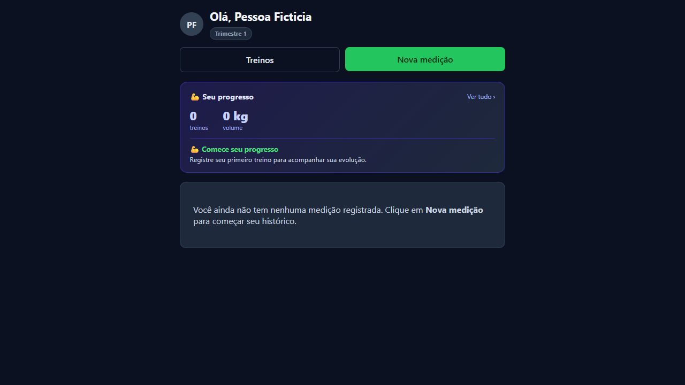

# Tarefa 01 — Ambiente local

Validação em 27/10/2026 (America/Sao_Paulo). Branch `chore/v2-base-local`, criada após `git fetch origin`, a partir de `origin/main` no commit `23ab62d46a77683f38df72c38d8b2785ea19bce8`. Estado inicial limpo; nenhum trabalho anterior foi sobrescrito. README.md e TECHNICAL.md lidos; nenhum AGENTS.md encontrado. Nenhum push, merge, publicação ou alteração de produção.

## Versões e requisitos

| Componente | Requisito do código | Executado nesta máquina |
| --- | --- | --- |
| .NET | Target net8.0; Docker usa SDK/runtime 8 | SDK 10.0.402, runtime ASP.NET/Core 8.0.32 |
| Node | Dependências do lockfile incluem requisito Node >=20 | Node 22.22.0 portátil para npm/build/Vite |
| npm | package-lock v3 | 10.9.4, instalação com npm ci |
| PostgreSQL | Provider Npgsql/EF 8.0.11; versão de servidor não fixada no projeto | 16.6 portátil |
| PowerShell | Scripts usam RandomNumberGenerator.GetBytes(int) | PowerShell 7 |

O SDK 8 é a referência descrita pelo repositório, mas não estava instalado; o build foi efetivamente validado com SDK 10 visando net8.0. Não houve migração de plataforma. O README menciona React 18, mas package.json/lockfile atuais usam React 19.2.7; dependências preservadas.

## Configuração e isolamento

A API carrega appsettings.json, appsettings.Development.json, User Secrets em Development e variáveis de ambiente. Os scripts sobrescrevem explicitamente conexão e JWT por ambiente, sem ler ou imprimir secrets existentes. O frontend recebe `VITE_API_BASE_URL` no Vite e usa localhost:5000 como fallback. CORS já permite http://localhost:5173.

`scripts/start-local-api.ps1` ativa `LocalDevelopment__Enabled=true`, ambiente Development e conexão exclusivamente `Host=127.0.0.1;Port=55432;Database=personalite_v2_local;Username=personalite_local;Pooling=false`. A chave JWT é aleatória por execução: reiniciar a API exige novo login. Fotos ficam em `.local/fotos`.

Antes do registro do DbContext e da chamada automática a `Database.Migrate()`, o perfil local rejeita ambiente, host, porta ou banco divergentes. Fora desse perfil, o funcionamento existente permanece. Um host fictício `example.invalid` foi rejeitado com InvalidOperationException antes de conectar.

O PostgreSQL é um cluster novo em `.local/pgdata`, escutando somente 127.0.0.1:55432. Autenticação trust apenas em loopback permite dispensar senha nesse cluster descartável. Qualquer processo local pode acessá-lo; use apenas dados fictícios e não exponha a interface à rede. Não foram copiados dados de produção.

Consulta executada **antes da inicialização bem-sucedida da API**:

```sql
SELECT current_database(), current_user, inet_server_addr(), inet_server_port(), version();
-- personalite_v2_local | personalite_local | 127.0.0.1 | 55432 | PostgreSQL 16.6
```

Resend é substituído por `LocalEmailService` exclusivamente nesse perfil. O simulador escreve assunto/corpo no console e não faz chamadas HTTP. A solicitação real ao endpoint local de verificação gerou a mensagem `E-mail simulado local` no log. Nenhum e-mail foi enviado. Outros serviços: fotos em disco; nenhuma integração Supabase específica, apenas PostgreSQL.

## Repetir a preparação

Use PowerShell 7, .NET e Node/npm disponíveis no PATH. Nesta máquina os binários portáteis estão em `.local-tools`, ignorada pelo Git. Docker/psql/npm não estavam originalmente no PATH. Fontes oficiais usadas para os portáteis:

- Node: https://nodejs.org/dist/v22.22.0/win-x64/node.exe
- npm: https://registry.npmjs.org/npm/-/npm-10.9.4.tgz
- PostgreSQL: https://get.enterprisedb.com/postgresql/postgresql-16.6-1-windows-x64-binaries.zip

Para reproduzir exatamente os caminhos desta sessão, na raiz do repositório:

```powershell
New-Item -ItemType Directory -Force .local-tools | Out-Null
Invoke-WebRequest https://nodejs.org/dist/v22.22.0/win-x64/node.exe -OutFile .local-tools/node.exe
Invoke-WebRequest https://registry.npmjs.org/npm/-/npm-10.9.4.tgz -OutFile .local-tools/npm.tgz
tar -xf .local-tools/npm.tgz -C .local-tools
Invoke-WebRequest https://get.enterprisedb.com/postgresql/postgresql-16.6-1-windows-x64-binaries.zip -OutFile .local-tools/postgresql.zip
Expand-Archive .local-tools/postgresql.zip .local-tools/postgresql
$env:PATH = (Join-Path (Get-Location) '.local-tools') + ';' + $env:PATH
dotnet restore PersonaLite.sln
dotnet build PersonaLite.sln --no-restore
dotnet test PersonaLite.sln --no-build --no-restore
node .local-tools/package/bin/npm-cli.js ci --prefix client
node .local-tools/package/bin/npm-cli.js run build --prefix client
./scripts/start-local-db.ps1
./scripts/start-local-api.ps1
```

Com PostgreSQL instalado em outro caminho, passe `-PgBin 'C:/caminho/pgsql/bin'` ao script de banco. O script inicia o cluster e cria o banco se ausente; se o cluster já estiver em execução, não o execute novamente. Não execute o início rápido antigo sem verificar a conexão: a API aplica migrations automaticamente.

Em outro terminal, na raiz:

```powershell
$env:VITE_API_BASE_URL = 'http://localhost:5000'
./.local-tools/node.exe client/node_modules/vite/bin/vite.js client --host localhost --port 5173 --strictPort
```

Alternativa com npm no PATH: `cd client; npm ci; npm run build; npm run dev -- --host localhost --port 5173 --strictPort`. O exemplo `client/.env.development.local.example` pode ser copiado para `.env.development.local` (ignorado). Verifique arquivos `.env*` próprios antes de usar comandos diferentes dos acima.

Após a API iniciar, em outro terminal:

```powershell
./scripts/seed-local.ps1
Get-Content .local/demo.json
```

O seed cria `demo_local`, nome Pessoa Ficticia, e-mail `demo@example.invalid` e senha aleatória, guardada somente no arquivo ignorado. Valida login, consulta autenticada e solicita e-mail simulado. Se o arquivo já existe, reutiliza a conta; para um cluster novo use um arquivo de credenciais novo também. Não publique esse arquivo. Abra http://localhost:5173/login e entre com as credenciais locais.

Para parar: Ctrl+C nos terminais de frontend/API e, na raiz:

```powershell
./.local-tools/postgresql/pgsql/bin/pg_ctl.exe -D .local/pgdata -m fast -w stop
```

Não remova o cluster para reiniciar; seus dados fictícios persistem. Os serviços ficaram iniciados ao final para inspeção.

## Resultados e evidências

| Comando/verificação | Resultado efetivo |
| --- | --- |
| git status --short --branch / git remote -v | main limpa, origin correto |
| git fetch origin / git switch -c chore/v2-base-local origin/main | Sucesso |
| dotnet restore PersonaLite.sln | Cinco projetos restaurados |
| dotnet build PersonaLite.sln --no-restore | Sucesso, 0 avisos, 0 erros |
| dotnet test PersonaLite.sln --no-build --no-restore | 11 aprovados, 0 falhas, 0 ignorados |
| npm ci | 410 pacotes instalados; package-lock preservado |
| npm run build | TypeScript + Vite + PWA concluídos |
| initdb / pg_ctl / createdb / psql | Cluster exclusivo PostgreSQL 16.6 criado e destino confirmado |
| start-local-api.ps1 | Cinco migrations aplicadas, Development em localhost:5000 |
| GET /api/saude | 200, status ok |
| seed-local.ps1 | Cadastro/login/consulta autenticada/verificação simulada bem-sucedidos |
| Navegador em localhost:5173 | Login via formulário; página inicial mostrou Pessoa Ficticia, Trimestre 1 e progresso vazio |
| SQL após execução | 5 registros em __EFMigrationsHistory; apenas demo_local em Usuarios |
| git diff --check | Sem erros de whitespace |



## Problemas e limitações

- Restrições do sandbox bloquearam escrita em .git/.dotnet e TCP em loopback; fetch, criação da branch, restore/build/testes e serviços precisaram de execução autorizada fora do sandbox. A primeira tentativa de build falhou sem diagnóstico de código; fora do sandbox passou. A primeira API abortou por conexão recusada antes de o PostgreSQL estar acessível; após iniciar o cluster fora do sandbox, passou. O navegador também só acessou o Vite iniciado fora do sandbox.
- `dotnet --info` no sandbox encontrou acesso negado ao Service Control Manager, mas informou SDK/runtimes. Nenhuma correção no produto foi necessária para esse problema do ambiente.
- npm audit resumiu 13 vulnerabilidades (5 low, 1 moderate, 7 high). Não foi feito audit fix nem alteração de lockfile. Investigar dependências em tarefa própria.
- Vite avisou de chunk JS acima de 500 kB (724,58 kB antes de gzip). Otimização fora do escopo.
- Frontend não possui script de testes; não há suíte E2E existente. A verificação de navegador foi manual automatizada, não cobertura completa de funcionalidades. Não foram testados instalação PWA, uso offline, uploads, recuperação de senha ou dispositivos móveis.
- SDK 8 não foi executado nesta máquina; PostgreSQL não tem versão fixada pelo projeto. Docker não foi usado. Os binários portáteis não são versionados.
- Alterações de código se limitam à proteção/configuração do perfil local e ao simulador de e-mail; nenhuma funcionalidade de negócio ou migration foi alterada.

## Arquivos e commit sugerido

- `.gitignore`: exclui ferramentas, banco, fotos e credenciais locais.
- `src/PersonaLite.Api/Program.cs`: valida destino antes das migrations e seleciona o simulador no perfil local.
- `src/PersonaLite.Api/LocalEmailService.cs`: captura e-mails locais sem envio.
- `scripts/start-local-db.ps1`, `scripts/start-local-api.ps1`, `scripts/seed-local.ps1`: comandos reproduzíveis e dados fictícios.
- `client/.env.development.local.example`: destino local explícito do frontend.
- `docs/v2/01-ambiente-local.md` e `docs/v2/evidencias/01-local.png`: procedimento e evidência.

Mensagem sugerida: `chore: prepara e valida ambiente local isolado para v2`.
