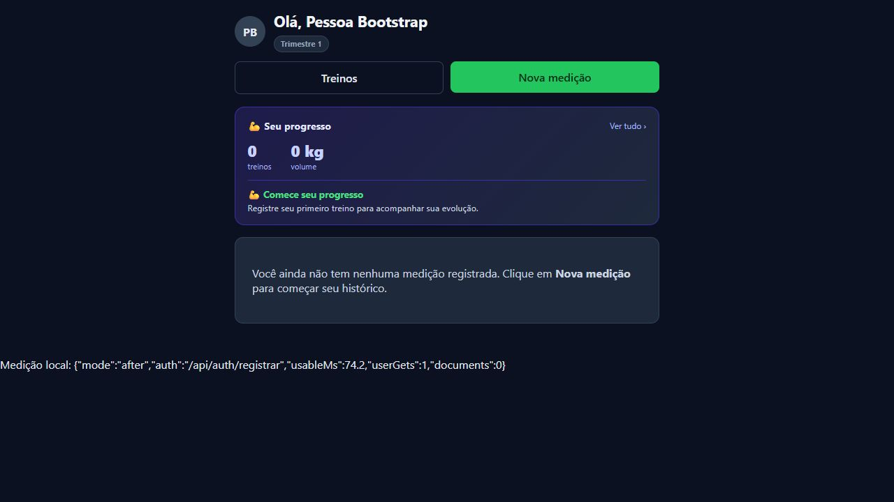

# Tarefa 01 — Remover recarga completa após autenticação

Nota de consolidação: após concluir as validações abaixo, o usuário solicitou commit e push de todas as alterações do chat. Os arquivos da preparação local e do diagnóstico foram reunidos nesta branch, preservando a documentação e as evidências de cada etapa. As referências abaixo à ausência de alterações de backend descrevem o escopo da implementação de autenticação; o commit consolidado também contém a configuração local e o simulador de e-mail da etapa anterior.

Validação em 27/10/2026 (America/Sao_Paulo). Branch: `perf/v2-auth-bootstrap`, criada de `origin/main` atualizado no commit `23ab62d46a77683f38df72c38d8b2785ea19bce8`.

## Preservação do trabalho anterior

README.md e instruções de setup/testes em TECHNICAL.md foram consultados. Nenhum AGENTS.md encontrado. A pasta original estava na branch `chore/v2-base-local`, com alterações não commitadas da preparação local e documentação de diagnóstico. Para não misturar os trabalhos, esta tarefa foi feita no worktree:

`C:/Users/Arthur/Documents/PersonaLite/.local-tools/auth-bootstrap`

Comandos: `git status --short --branch`, `git diff --stat`, `git fetch origin` e `git worktree add -b perf/v2-auth-bootstrap .local-tools/auth-bootstrap origin/main`. Os arquivos anteriores continuam na pasta original. As alterações desta tarefa estão somente no worktree indicado, ainda sem commit. Não houve push, merge, publicação ou alteração de produção.

## Comportamento anterior

- Login.tsx e Registrar.tsx salvavam o token, navegavam e chamavam `window.location.reload()`.
- App.tsx mantinha sua própria instância de useUsuario, aguardando GET /api/usuario antes de montar as telas.
- Treinos.tsx, Perfil e outras telas instanciavam o mesmo hook com estado e consulta independentes.
- O interceptor de 401 e o logout também provocavam navegação completa do documento.
- Havia 11 testes de domínio no backend. O frontend não tinha script ou suíte de testes.

Antes das alterações, foi executado `npm ci` e `npm run build` na cópia da main. O build foi preservado fora do worktree para a comparação posterior. As versões e comandos já usados no projeto foram mantidos: Vite 5.4.21, React 19.2.7, Node 22.22.0 e npm 10.9.4; testes .NET executados com SDK 10.0.402 e alvo net8.0.

## Implementação

`UsuarioProvider`, montado uma vez no App, é o único responsável pelo bootstrap e pela revalidação do usuário. useUsuario agora consome esse contexto: as chamadas existentes em Treinos e nas demais telas reutilizam o mesmo estado, sem novos GETs ao montar. Não foi necessário editar Treinos.tsx.

O token continua usando o mecanismo existente de localStorage; salvar/remover o token notifica o React via useSyncExternalStore. Eventos de storage também invalidam a sessão em outras abas. **O objeto de usuário fica apenas em memória na árvore do App**, sem cache persistente, singleton de dados privados ou compartilhamento entre contas.

Login/cadastro navegam com replace após salvar o token, sem reload. A API de autenticação só retorna token, id e nome, portanto permanece necessário um GET /api/usuario para obter o perfil completo. O bootstrap em andamento é reaproveitado inclusive durante o replay de efeitos do StrictMode.

Enquanto esse primeiro GET está pendente, é exibido carregamento e uma ação para sair. Em falha ou usuário ausente, há erro com retry e saída; retry não refaz o POST de autenticação. Revalidações posteriores mantêm a tela e o usuário existentes visíveis, com aviso de atualização/erro. Uma nova sessão não recebe os dados da conta anterior.

Logout limpa o token e volta ao login por navegação do React. Um 401 de chamada autenticada atual encerra a sessão sem reload e remove as telas protegidas. Respostas atrasadas de outro token não encerram a sessão nova nem repõem usuário antigo. Login inválido não é tratado como expiração de outra sessão. Rotas protegidas sem sessão direcionam ao login. Recuperação de senha não foi alterada.

Não houve alteração de backend, migrations, histórico, hospedagem ou regras de negócio. A API local da preparação anterior foi reutilizada como serviço de teste; suas alterações anteriores não fazem parte desta branch.

## Testes e comandos

Na pasta `client`:

```powershell
npm ci
npm test
npm run build
```

Na raiz deste worktree:

```powershell
dotnet test PersonaLite.sln
git diff --check
git diff -- src
```

Nesta máquina, npm não está no PATH global. Os comandos npm foram invocados como `node C:/Users/Arthur/Documents/PersonaLite/.local-tools/package/bin/npm-cli.js ...`, com o Node portátil no PATH. A reinstalação final usou `npm ci --offline --cache C:/Users/Arthur/Documents/PersonaLite/.local-tools/npm-cache`.

O sandbox bloqueou a criação do link da dependência preexistente `client: file:` em node_modules (EPERM). A instalação limpa foi repetida com autorização fora do sandbox e concluiu com 472 pacotes instalados. Nenhuma mudança nessa dependência foi feita para contornar o problema.

| Verificação | Resultado |
| --- | --- |
| Build da main anterior | TypeScript, Vite e PWA concluídos |
| Build do frontend alterado | TypeScript, Vite e PWA concluídos |
| npm test | 13 aprovados, 0 falhas, 0 ignorados |
| dotnet test PersonaLite.sln | 11 aprovados, 0 falhas, 0 ignorados |
| git diff --check | Sem erros de whitespace |
| git diff -- src | Vazio: nenhum arquivo de backend alterado |

A suíte nova usa o runner nativo do Node, tsx, jsdom, Testing Library e fake-indexeddb; não altera o Vite nem as plataformas da aplicação. As dependências de teste foram fixadas e o lockfile foi atualizado intencionalmente. A comparação das versões dos pacotes preexistentes no lockfile encontrou **zero versões alteradas**.

Os testes renderizam App e rotas reais, com respostas HTTP controladas por um adapter Axios, sem acessar produção. Cobrem:

1. Login, navegação para Treinos e um único GET, inclusive em StrictMode.
2. Cadastro, sessão e carregamento do perfil.
3. Login inválido sem bootstrap.
4. Proteção de rotas sem sessão.
5. Sessão restaurada e logout com remoção de dados.
6. Expiração/401 no bootstrap.
7. Falha e retry sem repetir autenticação.
8. Saída durante carregamento e resposta tardia.
9. Revalidação compartilhada sem desmontar consumidores.
10. Resposta 401 atrasada de token antigo.
11. Expiração durante o uso de tela protegida.
12. Usuário ausente com erro recuperável.
13. Logout por evento de storage de outra aba.

## Validação real local e chamadas HTTP

API: `http://localhost:5000`, reutilizando o perfil local já validado, com PostgreSQL `127.0.0.1:55432/personalite_v2_local` e e-mails simulados. Frontend: `http://localhost:5173`. Nenhuma credencial de produção foi utilizada.

Login testado com a mesma conta `demo_local` antes/depois. Cadastro feito pelo formulário com duas contas fictícias distintas, mesmo nome Pessoa Bootstrap, mesmos dados de perfil e domínio reservado example.invalid. As senhas não estão neste documento nem nos artefatos versionados. Treinos foi aberto pela navegação da aplicação após cada autenticação.

| Fluxo e fase | Antes | Depois |
| --- | --- | --- |
| POST /api/auth/login | 1, HTTP 200 | 1, HTTP 200 |
| GET /api/usuario após login | 1, HTTP 200 | 1, HTTP 200 |
| GET /api/usuario adicionais ao abrir Treinos | 1, HTTP 200 | **0** |
| POST /api/auth/registrar | 1, HTTP 200 | 1, HTTP 200 |
| GET /api/usuario após cadastro | 1, HTTP 200 | 1, HTTP 200 |
| GET /api/usuario adicionais ao abrir Treinos após cadastro | 1, HTTP 200 | **0** |
| Novas cargas do documento após cada resposta de autenticação | 1 | **0** |

As demais chamadas normais de Dashboard/Treinos continuam existindo. GET /api/planos-treino/atual retornou 404 nas contas sem plano, conforme o fluxo existente. O Dashboard de uma conta recém-criada também executou a criação automática de trimestre já existente no produto; esse comportamento não foi modificado.

## Comparação de tempo

Foi usado o **build de produção** de cada variante, na mesma máquina, navegador, origem, API e banco locais, sequencialmente, sem throttling. O servidor temporário de medição desabilitou cache HTTP e o registro de service worker em ambas as variantes. Isso evita confundir o replay de efeitos do StrictMode de desenvolvimento com o comportamento de produção.

Início: evento XHR com readyState 4 e HTTP 200 da autenticação. Fim: presença do link navegável Treinos no cabeçalho do Dashboard, seguida de dois requestAnimationFrame. É uma medida do bootstrap até o Dashboard navegável, **não de todos os dados carregados nem da duração do POST de autenticação**. Os demais cards podem continuar carregando. O contador de documentos e os eventos XHR sobrevivem ao reload apenas no harness de teste, via sessionStorage de métricas, sem token, corpo, nome ou dados de usuário.

| Resposta de autenticação → Dashboard navegável | Antes | Depois |
| --- | --- | --- |
| Login | 163,0 ms | 70,1 ms |
| Cadastro | 172,3 ms | 74,2 ms |

**Uma amostra por fluxo/variante.** Os números são observações locais, sujeitos a aquecimento de conexões/API e agendamento do navegador; não constituem p95, comparação estatística ou promessa de ganho em produção. A evidência principal é a remoção do documento novo e da segunda consulta ao usuário ao navegar.

Resumo numérico: [evidencias/02-auth-metrics.json](evidencias/02-auth-metrics.json).



### Repetir a medição

O harness está em `client/tests/auth-measure-server.mjs`, fora do código empacotado da aplicação. Com a API local já iniciada e o build desejado disponível, execute na raiz:

```powershell
node client/tests/auth-measure-server.mjs client/dist after .local/medicoes-auth.jsonl
```

Abra http://localhost:5173/login, autentique uma conta fictícia e navegue para Treinos. Para cadastro, saia da conta e use o formulário. O rodapé de medição mostra o tempo e a quantidade inicial de GETs; o JSONL registra os contadores subsequentes ao navegar. `documents` conta documentos novos depois da resposta de autenticação, não a abertura inicial da página.

Para comparar a main, gere seu build em outro checkout sem alterar este trabalho, sirva esse dist com o mesmo harness e rótulo `before`, usando a mesma API/origem. Pare um servidor antes de iniciar o outro na porta 5173. Não use os dados persistidos de um service worker anterior para essa comparação; use uma origem/perfil limpo de testes. Encerre com Ctrl+C. O harness serve somente loopback, remove o script de registro PWA no HTML servido e não modifica o dist.

## Arquivos alterados e motivos

| Arquivo | Motivo |
| --- | --- |
| .gitignore | Ignorar saídas temporárias em .local |
| client/src/components/UsuarioProvider.tsx | Bootstrap único, revalidação, isolamento de sessão e proteção de respostas atrasadas |
| client/src/hooks/useUsuario.ts | Consumir o contexto compartilhado |
| client/src/App.tsx | Montar provider e estados de carregamento/erro sem bloquear revalidação |
| client/src/api/authToken.ts | Notificar mudanças de token na mesma aba e entre abas |
| client/src/api/httpClient.ts | Tratar 401 sem reload e ignorar 401 de sessão anterior; acesso opcional ao ambiente para execução dos testes |
| client/src/pages/Login.tsx e Registrar.tsx | Remover reload e navegar com replace |
| client/src/pages/Perfil.tsx | Logout por navegação React para login |
| client/package.json e package-lock.json | Script de teste e dependências de desenvolvimento fixadas |
| client/tests/auth.test.tsx, setup.mjs e css-loader.mjs | Testes de integração e ambiente DOM/IndexedDB isolado |
| client/tests/auth-measure-server.mjs | Harness reproduzível de contagem HTTP e comparação antes/depois |
| docs/v2/02-fluxo-autenticacao.md e evidencias/02-auth-* | Procedimento, resultados e evidências |

## Limitações e escopo

- Nenhuma medição autenticada de produção nesta tarefa; a lentidão de produção **não é declarada resolvida**.
- Cold start, regiões, consultas de histórico e índices de banco permanecem fora do escopo.
- Permanecem os 13 alertas de dependências já presentes no projeto (5 low, 1 moderate, 7 high) e o aviso de bundle maior que 500 kB. Nenhum audit fix foi aplicado. A reinstalação offline não substitui a auditoria online já realizada na instalação.
- Testes de erro/expiração/concorrência usam respostas controladas; login, cadastro, logout e navegação foram também conferidos contra a API local real.
- O PWA foi excluído intencionalmente do benchmark; comportamento offline e instalação não foram reavaliados.
- O backend local em execução pertence à preparação anterior. O novo fluxo de autenticação não exige alterações de backend; os arquivos de configuração local dessa etapa anterior foram posteriormente incluídos na consolidação solicitada pelo usuário.
- O objeto de usuário não é persistido pelo provider; o armazenamento de token e o mecanismo de fila offline preexistentes não foram redesenhados.

Mensagem de commit sugerida: `perf: compartilha bootstrap do usuário e remove reload após autenticação`.
